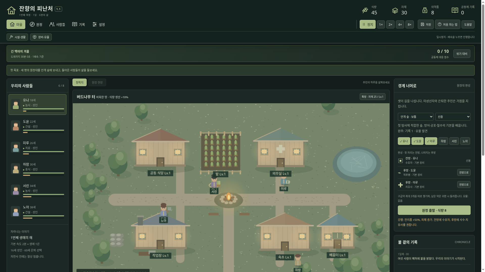
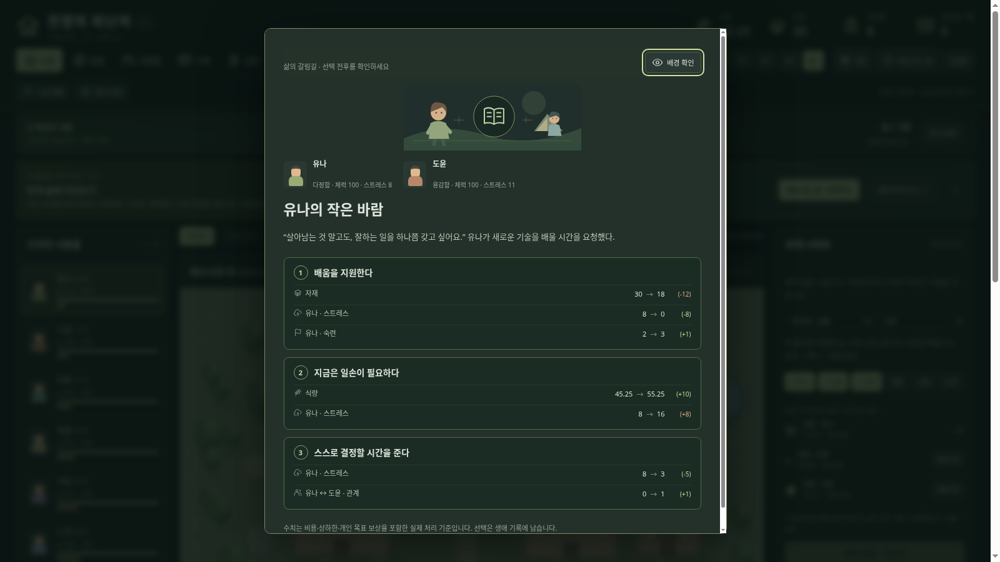

# 잔향의 피난처 — Windows 다운로드

## 최신판: 1.1.0 · 1단계 화면·선택 개선

**[윈도우 본판 ZIP 다운로드](https://github.com/wkion154/-/raw/refs/heads/downloads/releases/Hearth-of-Echoes-1.1.0-Windows-x64.zip)**

### 업데이트 방법

1. 이전 게임에서 저장하고 게임 탭과 검은 실행 창을 닫습니다.
2. 새 ZIP 전체를 새 폴더에 압축 해제합니다.
3. `Start.cmd`를 더블클릭하면 기본 브라우저에서 열립니다.
4. 같은 브라우저에서는 기존 저장이 이어집니다. 「새 여정」으로 초기화하지 않아도 됩니다.

Windows 10/11 x64와 최신 Edge 또는 Chrome을 사용합니다. Node.js 런타임이 포함되어 별도 설치·인터넷·API 키가 필요 없습니다. 게임 중 실행 창을 열어 두고, 종료 전 저장한 뒤 탭을 닫고 실행 창에서 Ctrl+C를 누르세요.

### 이번 업데이트

- 자원·메뉴·배속을 상단 고정하고 **마을 / 원정 / 사람들 / 기록 / 설정**으로 정리했습니다.
- 자원·시설·장비·생활에 그림 아이콘, 사건에 삽화와 관련 주민 초상화를 추가했습니다.
- 메뉴 11곳의 첫 사용 안내를 제공합니다. **설정 → 도움말·튜토리얼**에서 다시 보기·안내 이력 초기화를 할 수 있습니다.
- 사건·위기 최종 선택의 **배경 확인**으로 창을 내리고 주민과 마을을 살펴볼 수 있습니다. 시간과 진행 변경은 잠기며, 아래 **선택 창 다시 열기**로 돌아와 결정합니다.
- 선택지에 **현재 → 선택 후 값**을 표시하고, 실제 반영 결과도 요약과 기록에 남깁니다. 비용·수치 상하한·관계·개인 목표 보상·자연사 영향을 함께 반영합니다.

이 버전은 약속한 **1단계**입니다. **4인 주사위 생성·외형 커스터마이징·건물과 길 배치는 다음 단계**이며, 기존 주민과 시설은 그대로 유지합니다.

[업데이트 설명](notes-1.1.md)

### 처음 시작한다면

1. **처음 하는 법 → 3단계 → 추천 배치 적용**을 누릅니다. 초기 상태에서 거점의 치료·농사·건설과 원정대의 수호자·척후병·치유사를 정합니다.
2. 4단계의 **원정 편성으로 가서 직접 해 보기**를 누릅니다.
3. 오른쪽 **안개 숲 / 신중**을 확인하고 **원정 출발 · 식량 8**을 누릅니다.
4. **1× 또는 2×**로 진행합니다. 전투는 자동이고 갈림길에서는 **안전한 우회로**를 고릅니다.
5. 귀환자는 휴식과 치료로 회복시킵니다. 이미 원정을 다녀왔다면 설명을 참고해 생활 역할을 직접 정할 수 있습니다.

저장은 같은 PC·브라우저의 로컬 저장소에 보존됩니다. 다른 PC로 옮길 때는 **설정 → 저장 내보내기 / 저장 파일 불러오기**를 사용하세요.

검증: 게임 규칙 테스트 **97개**, 자동 플레이 **24회**, 압축 해제본의 기존 브라우저 플레이와 1단계 UI 검증을 수행했습니다. Windows 실기 실행은 미검증입니다. 런타임 공식 체크섬·ZIP 및 내부 파일 체크섬을 확인했고, ZIP의 SHA256 파일도 함께 제공합니다.
