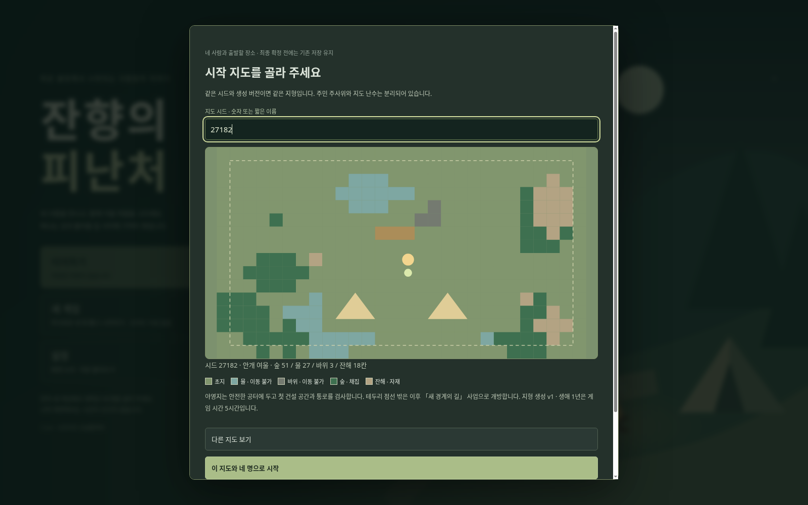
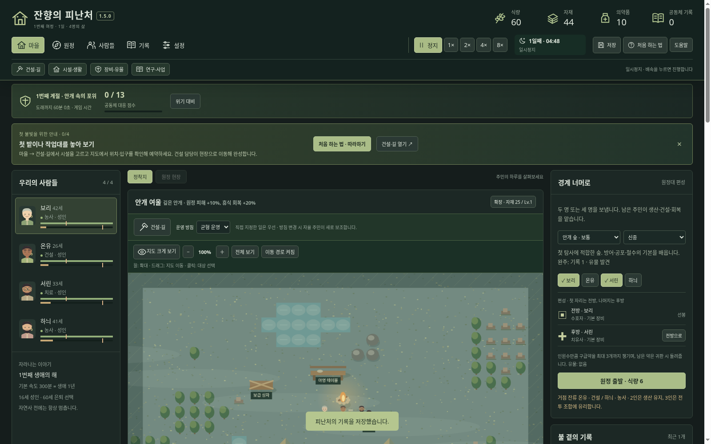
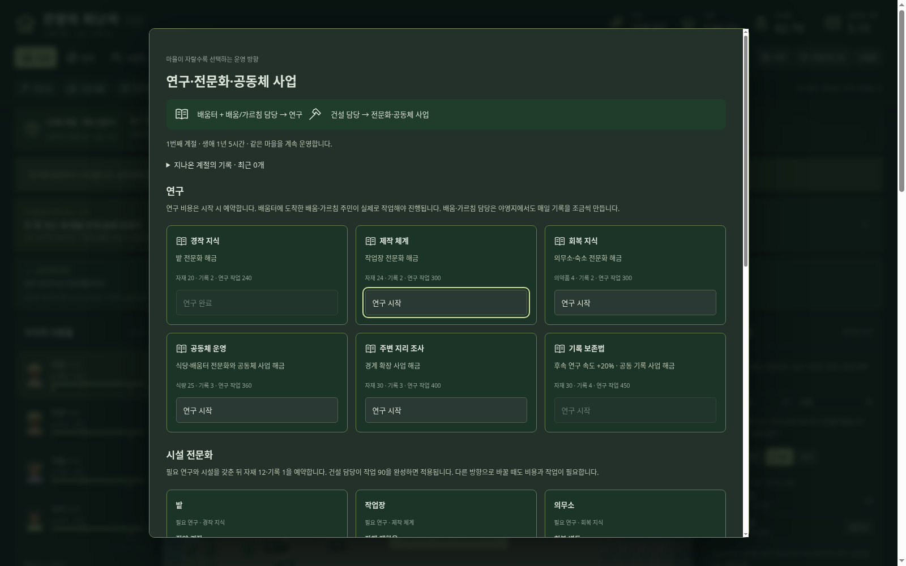

# 잔향의 피난처 — Windows 다운로드

## 최신판: 1.5.0 · 후속 2단계 정착 성장

**[윈도우 본판 ZIP 다운로드](https://github.com/wkion154/-/raw/refs/heads/downloads/releases/Hearth-of-Echoes-1.5.0-Windows-x64.zip)**

### 실행과 업데이트

1. 이전 게임에서 저장하고 **브라우저 게임 탭과 검은 실행 창을 모두 닫습니다**.
2. 새 ZIP 전체를 새 폴더에 압축 해제합니다.
3. `Start.cmd`를 실행하고 타이틀의 **이어하기**를 선택합니다.

같은 PC·브라우저·주소(127.0.0.1:43187)의 기존 저장을 유지합니다. 설정의 저장 내보내기로 사본을 보관할 수 있습니다. Windows 10/11 x64와 최신 Edge/Chrome용이며 공식 Node 런타임이 포함됩니다. 인터넷·API 키·별도 Node 설치가 필요 없습니다.

### 이번 업데이트

- **주민별 성장:** 10가지 분야 능력, 적성, 장단점이 있는 특성 두 개. 실제 수행한 분야에 경험이 쌓이고 능력 6 이상의 성인은 전문 분야를 선택합니다. 강점 요약부터 보고 세부 수치는 펼쳐 봅니다.
- **시작 지도 선택:** 네 명을 뽑고 꾸민 뒤 시드를 입력하거나 다시 뽑습니다. 실제 지형 미리 보기와 최종 출발 확인을 제공합니다. 물·바위는 건설·이동을 막고 첫 야영지 공간과 초기 연결성을 검사합니다.
- **마을 성장:** 연구 6종, 시설 전문화 12종, 공동체 사업 3종. 담당자가 실제로 이동해 작업하며 생산·회복·정원·연구·건설 범위에 효과가 반영됩니다. 진행 게이지와 비용 확인·미사용분 취소 반환을 제공합니다.
- **오래 이어지는 공동체:** 새 게임의 생애 1년은 1배속 5시간. 게임 시간 60분마다 돌아오는 계절 위기에 대응한 뒤 같은 주민·마을에서 다음 계절을 맞습니다. 실패와 대피도 바로 회차 종료가 되지 않습니다.
- **기존 저장 보존:** 옛 저장은 기존 규칙을 유지합니다. 「마을 → 연구·사업」에서 설명을 확인하고 장기 정착으로 전환할 수 있습니다. 기존 지형·주민·시설을 유지하며 새 지형은 새 게임에서만 생성합니다.
- **설명과 결과:** 새 메뉴의 첫 사용 안내·설정에서 다시 보기, 능력 경험과 수준 변화의 이전 → 이후 표시, 계절 기록을 추가했습니다. 기존 지도 확대·카메라·말풍선·툴팁·상단 고정도 유지합니다.

[상세 변경과 이전 저장 전환 설명](notes-1.5.md) · [초기 운영 검증 결과](foundation-balance-1.5.md) · [이전 화면·조작 개선](notes-1.4.md)

검증: 규칙 테스트 **165개**, 500개 시드의 초기 지형 연결성, 초기 자원 그대로 18개 운영 시나리오의 연구·전문화·두 계절 지속, 실제 브라우저와 압축 해제 배포본을 확인했습니다. ZIP CRC·내부 파일 SHA256·공식 Windows 런타임 체크섬을 검증했습니다. **Windows 실기 실행은 미검증**입니다.

대규모 지역·사건·퀘스트·보상·방치형 방어 확장은 다음 3단계입니다. 이번 버전은 장기 성장 기반이며 수백 시간의 콘텐츠나 장기 경제 균형을 완성한 버전은 아닙니다.
