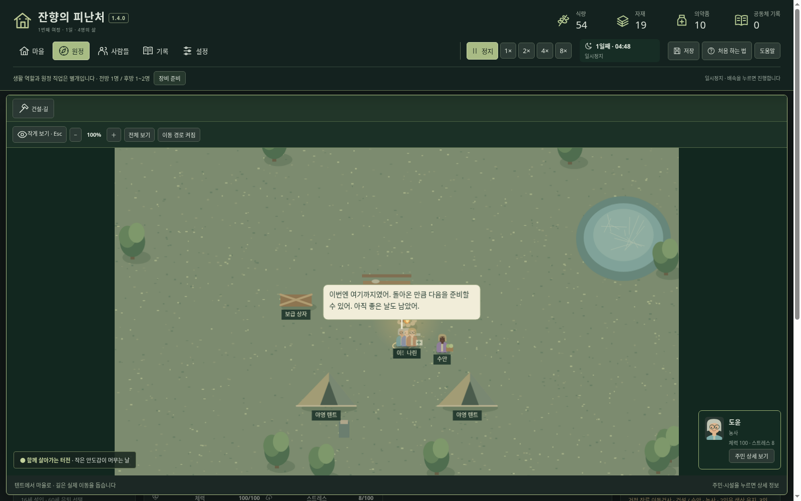
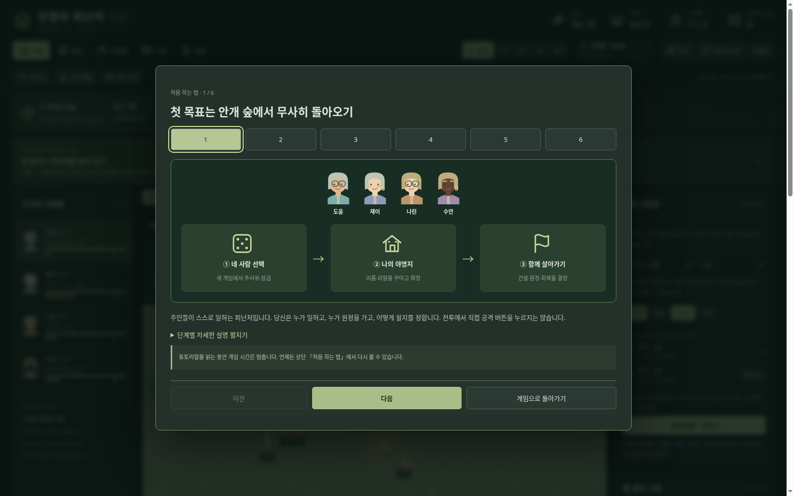

# 잔향의 피난처 — Windows 다운로드

## 최신판: 1.4.0 · 후속 1단계 화면·조작 개선

**[윈도우 본판 ZIP 다운로드](https://github.com/wkion154/-/raw/refs/heads/downloads/releases/Hearth-of-Echoes-1.4.0-Windows-x64.zip)**

### 실행과 업데이트

1. 이전 게임에서 저장하고 브라우저 게임 탭과 검은 실행 창을 모두 닫습니다.
2. 새 ZIP 전체를 새 폴더에 압축 해제합니다.
3. `Start.cmd`를 실행하고 타이틀의 **이어하기**를 선택합니다.

같은 PC·브라우저·주소의 기존 저장을 유지합니다. 먼저 설정의 저장 내보내기로 따로 보관할 수 있습니다. **새 게임**은 네 명 주사위·잠금·꾸미기로 시작하고, 확정 전까지 기존 저장이 유지됩니다. Windows 10/11 x64와 최신 Edge/Chrome용이며 Node 런타임이 포함됩니다. 인터넷·API 키·별도 Node 설치가 필요 없습니다.

### 이번 업데이트

- **부드러운 배속 이동:** 고정 게임 초와 프레임 표시를 분리하고 실제 경유점을 이어 그립니다. 8배에서도 앞선 이동을 한꺼번에 건너뛰던 문제를 수정했습니다.
- **지도 관찰:** 크게 보기·접기, 휠 확대·축소, 드래그 이동, 전체 보기 복귀, 선택한 주민의 경로 표시와 확대 화면에서의 상태·상세 조회. 확대 후 클릭·건설 좌표도 맞춰집니다.
- **게임 시계와 정보 정돈:** 날짜·게임 속 시각·배속·정지 이유, 가까이 묶인 위기 정보와 대응 게이지.
- **실행 전 확인:** 확장·출정·귀환·개선·제작·대비 투입·철거·예약 취소·은퇴·목표 진행 초기화의 영향 확인. 비용·잔류 인원·수용 인원·효과를 보고 확정합니다.
- **툴팁과 연결 강조:** 자원·역할·상태·성격·시설·장비·중요 버튼의 설명과 사용 불가 사유. 키보드로도 읽습니다.
- **그림 중심 안내:** 실제 주민 얼굴과 공통 아이콘, 번호·화살표로 여섯 단계 흐름을 보여주고 긴 설명은 접었습니다.
- **온전한 대화:** 말풍선 전문 줄바꿈, 지도 크기에 맞춘 글자 크기와 가장자리 보정, 현실 시간 기준의 읽기 여유, 발언마다 본인 얼굴·이름 표시.
- **정확한 원정 회고:** 체력·스트레스·장기전 등 자동 철수 이유를 구분합니다. 기존 기록 공간·최근 100개 표시도 유지합니다.

### 지도 조작

- 지도 위 휠: 포인터 중심 확대·축소. 지도 밖에서는 문서 스크롤.
- 짧은 클릭: 주민·시설 선택. 드래그: 지도 이동.
- 건설 중: 클릭으로 위치 지정, **가운데 버튼 또는 Space+드래그**로 이동.
- 전체 보기: 배율·위치 복귀. Esc 또는 작게 보기: 확대 화면 닫기.
- 중요한 선택의 배경 확인: 관찰·줌·이동만 가능하며 시간과 명령은 잠깁니다.

[상세 업데이트 설명](notes-1.4.md) · [타이틀 설명](notes-1.3.1.md) · [이전 기록 수정](notes-1.3.2.md)

이번 배포는 후속 **1단계**입니다. 분야별 능력·랜덤 시작 지형·장기 정착 구조는 2단계, 다양한 지역·방문·퀘스트·보상·자동 방어 확장은 이후 단계입니다. 현재 버전이 수백 시간 콘텐츠로 완성됐다는 뜻은 아닙니다.

검증: 규칙 테스트 **146개**, 배속별 동일 결과·모서리 경로, 실제 8배 캔버스 프레임 이동, 카메라 조작·좌표 판정·확인 취소·화자 얼굴·말풍선 전문·툴팁·그림 안내·선택 대기 잠금·세 와이드 해상도를 확인했습니다. 압축 해제본의 기존 플레이·타이틀·1/2/3단계 UI 회귀도 검증했습니다. 공식 런타임 체크섬·ZIP CRC·내부 파일 SHA256을 확인하고 체크섬 파일을 함께 제공합니다. Windows 실기 실행은 미검증입니다.
