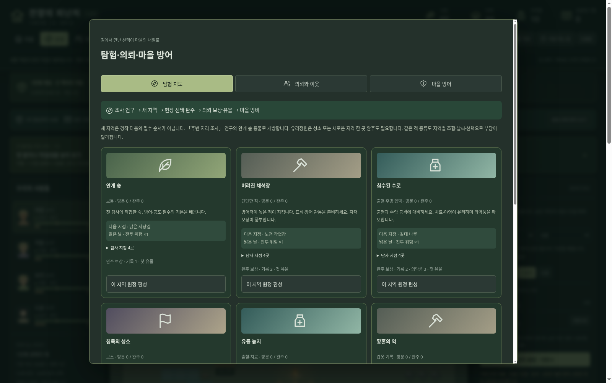
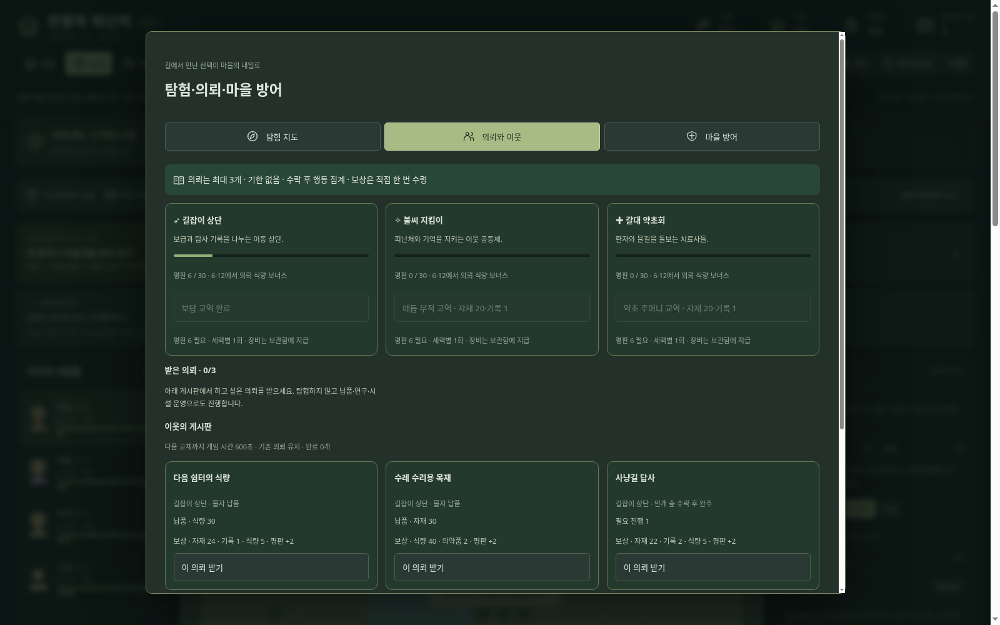
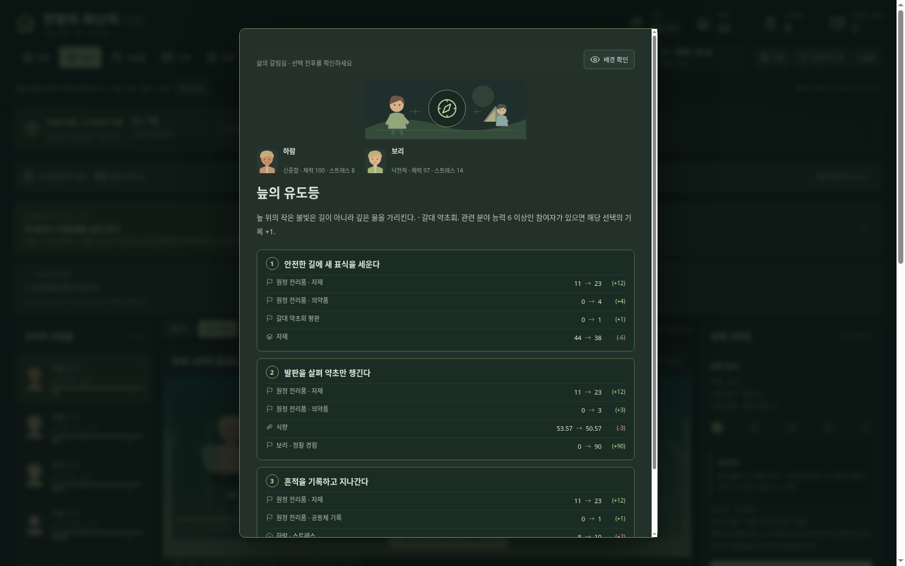
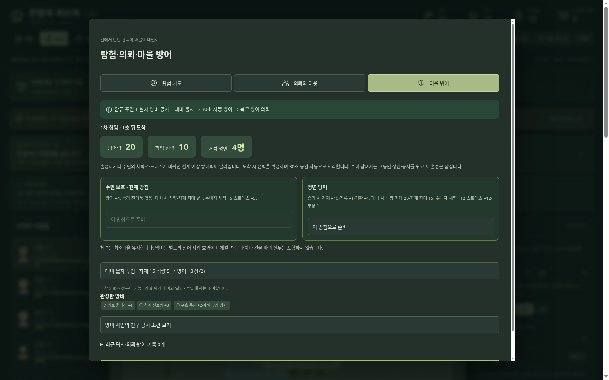

# 잔향의 피난처 — Windows 다운로드

## 최신판: 1.6.0 · 후속 3단계 탐험·의뢰·자동 방어

**[윈도우 본판 ZIP 다운로드](https://github.com/wkion154/-/raw/refs/heads/downloads/releases/Hearth-of-Echoes-1.6.0-Windows-x64.zip)**

### 실행과 업데이트

1. 이전 게임에서 저장하고 **브라우저 게임 탭과 검은 실행 창을 모두 닫습니다**.
2. 새 ZIP 전체를 새 폴더에 압축 해제합니다.
3. `Start.cmd`를 실행하고 타이틀의 **이어하기**를 선택합니다.

같은 PC·브라우저·주소(127.0.0.1:43187)의 저장을 유지합니다. 설정 → 저장 내보내기로 사본을 보관할 수 있습니다. Windows 10/11 x64와 최신 Edge/Chrome용이며 공식 Node 런타임이 포함됩니다. 인터넷·API 키·별도 Node 설치가 필요 없습니다.

### 이번 업데이트

- **신규 지역 4곳, 총 8곳:** 유등 늪지·황혼의 역·메아리 능선·유리정원. 지리 조사 연구와 안개 숲 등불로 개방합니다. 지역별 적 조합·날씨 위험·보상·배경 그림을 제공합니다.
- **새 사건 36개:** 원정 24개·마을 12개를 직접 작성했습니다. 사건당 세 선택(공통 통과 선택 포함)이 물자·분야 경험·관계·평판에 연결됩니다. 관련 능력이 좋은 참여자는 추가 기록을 확보합니다. 현장 전리품은 귀환할 때 한 번 지급합니다.
- **의뢰 18종과 세 이웃:** 납품·탐사·시설·연구·방어·사건 선택 목표를 받고 최대 세 개를 기한 없이 진행합니다. 게시판은 게임 시간 10분마다 교체합니다. 완료 보상은 직접 받고 평판으로 추가 식량·일회성 장비 교역을 엽니다.
- **신규 유물 4개, 총 9종:** 전투 치료·정찰·스트레스·공격 효과를 지역 완주로 얻습니다. 활성화는 한 개입니다.
- **방치형 자동 방어:** 잔류 성인의 능력·몸과 마음, 실제 연구·공사로 완성한 방비 사업, 투입 물자와 방침이 전력에 반영됩니다. 도착 후 30초 동안 자동으로 처리하고 결과·기억·의뢰 진행을 남깁니다. 벽·문 자유 배치나 건물 파괴 전술전은 아닙니다.
- **한곳에서 확인:** 「탐험·의뢰」의 지도 / 의뢰와 이웃 / 마을 방어 세 탭으로 묶었습니다. 아이콘·게이지·전력 비교·첫 사용 안내와 다시 보기를 제공합니다. 비용·방침 변경·포기는 확인 후 진행합니다.

1.5 장기 정착 저장은 새 게임 없이 이어서 새 활동을 이용합니다. 기존 주민·시설·능력·지형·진행 중 전투를 유지합니다. 더 오래된 호환 방식 저장은 연구·사업에서 장기 정착으로 전환하면 새 활동이 시작됩니다.

[세부 규칙·변경과 제한](notes-1.6.md) · [초기 자원 그대로 18회 운영 결과](frontier-balance-1.6.md) · [이전 정착 성장 업데이트](notes-1.5.md)

검증: 규칙 테스트 **183개**, 새 사건 108개 선택 경로의 예측·실행·저장 일치, 신규 네 지역의 실제 전투·완주·유물·귀환, 의뢰·평판·방비 노동·방어 중간 저장을 확인했습니다. 초기 자원·능력을 늘리지 않은 18개 운영 시나리오와 Chromium·압축 해제 배포본도 확인했습니다. 공식 런타임 체크섬·ZIP CRC·내부 파일 SHA256을 검증했습니다. **Windows 실기 실행은 미검증**입니다.

후속 세 단계의 기반과 첫 콘텐츠 묶음을 연결했습니다. 수백 시간 콘텐츠·장기 경제 균형을 완성한 버전은 아니며 사건·의뢰·적·지역 변화와 균형은 앞으로 계속 확장할 수 있습니다.
