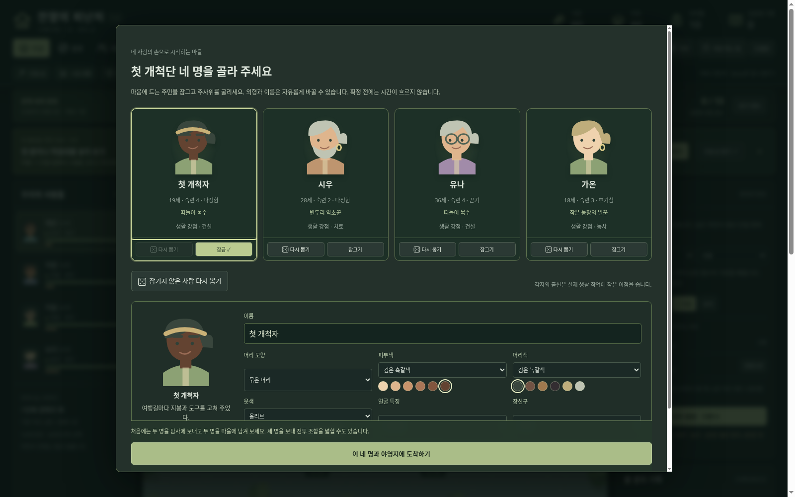
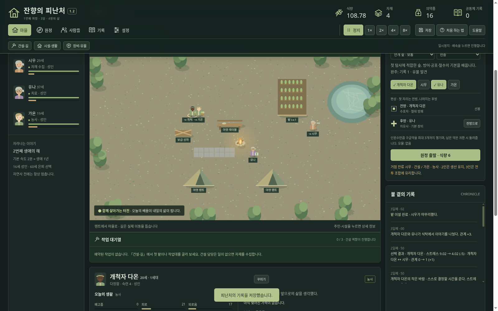

# 잔향의 피난처 — Windows 다운로드

## 최신판: 1.2.0 · 네 명의 개척단과 직접 짓는 마을

**[윈도우 본판 ZIP 다운로드](https://github.com/wkion154/-/raw/refs/heads/downloads/releases/Hearth-of-Echoes-1.2.0-Windows-x64.zip)**

### 실행과 업데이트

1. 이전 게임을 저장하고 브라우저 게임 탭과 검은 실행 창을 모두 닫습니다.
2. 새 ZIP 전체를 새 폴더에 압축 해제합니다.
3. `Start.cmd`를 더블클릭합니다. 같은 PC·브라우저에서는 기존 저장이 이어집니다.

Windows 10/11 x64와 최신 Edge 또는 Chrome용입니다. Node.js 런타임이 포함되어 별도 설치·인터넷·API 키가 필요 없습니다. 게임 중 실행 창을 열어 두세요.

**기존 여섯 명과 시설은 유지됩니다.** 새로운 네 명의 야영지를 경험하려면 먼저 **설정 → 저장 내보내기**로 보관한 뒤 **새 여정**을 선택하세요. 주민을 확정하기 전에는 취소해 기존 마을로 돌아갈 수 있습니다. 확정하면 현재 저장이 새 게임으로 바뀝니다.

### 이번 업데이트

- **네 명 직접 뽑기:** 개별·전체 주사위, 잠금, 미확정 구성 복원.
- **이름과 외형 꾸미기:** 머리·피부·옷·얼굴 특징·장신구를 초상화·지도·전투에 동일하게 적용.
- **텐트에서 시작:** 모닥불·테이블·상자를 갖춘 작은 야영지에서 출발.
- **직접 건설:** 시설 위치·방향을 지정하고 건설 담당자가 이동해 완성. 예약 순서 변경·취소·시설 이설·철거 지원.
- **길과 제작:** 흙길·포장길의 실제 이동 속도 효과, 작업 대기열을 통한 장비 제작.
- **2인 또는 3인 원정:** 두 명을 남겨 마을을 돌볼지, 한 명을 남기고 원정 전력을 높일지 선택.
- **운영 방침:** 균형·건설·회복과 개인 역할 지시, 자동 보조·회복 후 복귀.

[상세 업데이트 설명](notes-1.2.md)

각 메뉴의 첫 사용 안내와 **설정 → 도움말·튜토리얼**, **처음 하는 법**에서 플레이 방법을 볼 수 있습니다. 사건의 배경 확인·시간 정지·자원 전후 표시와 상단 고정 메뉴도 유지합니다.

이번 배포는 **2단계**입니다. 성격·기억·상황에 따른 풍부한 대화와 사회 행동은 다음 **3단계**에서 진행합니다.

저장은 같은 PC·브라우저에 보존됩니다. 다른 PC나 브라우저로 옮길 때는 저장 내보내기·불러오기를 사용하세요.

검증: 규칙 테스트 **117개**, 실제 규칙 자동 플레이 **42회**, 압축 해제본의 기존 플레이·1단계 UI·2단계 UI 브라우저 검증을 통과했습니다. Windows 실기 실행은 미검증입니다. 공식 런타임 체크섬, ZIP CRC와 내부 파일 SHA256을 확인했으며 배포 ZIP의 SHA256 파일을 함께 제공합니다.
