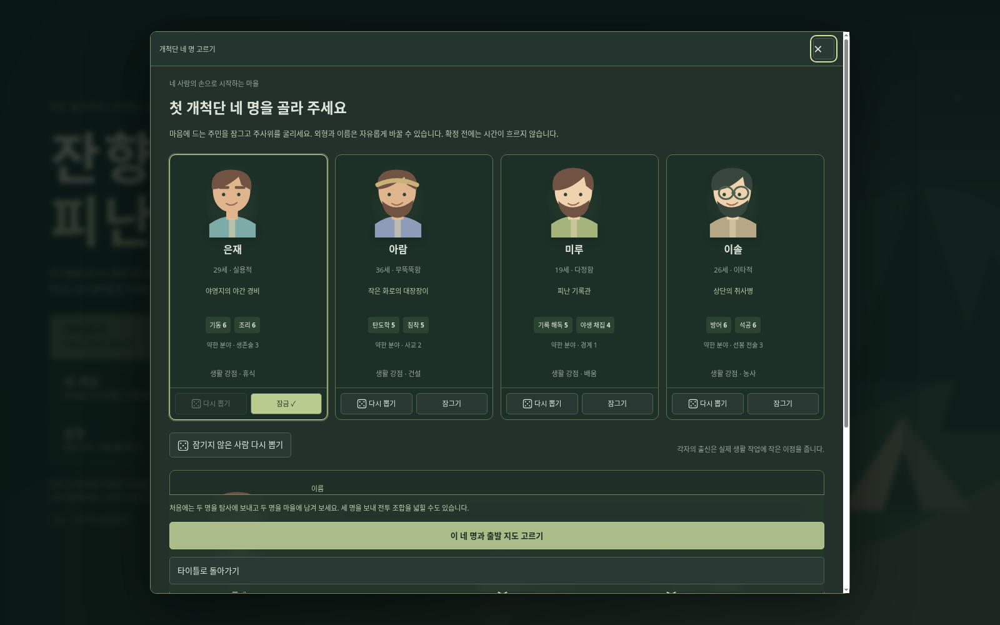
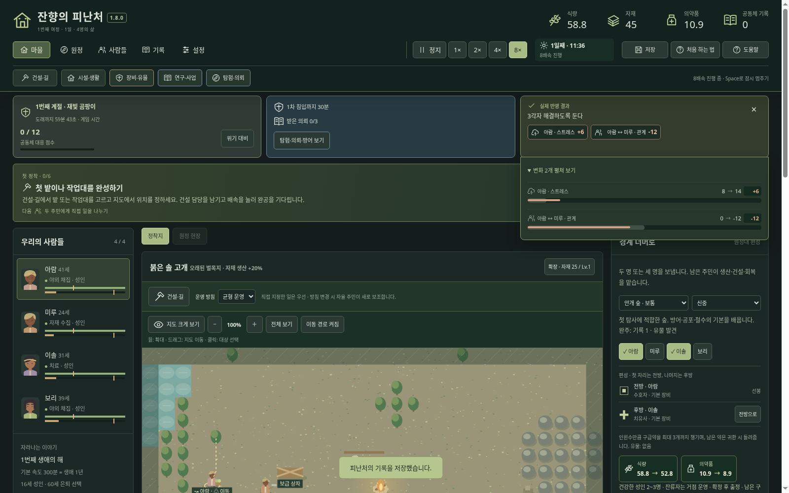
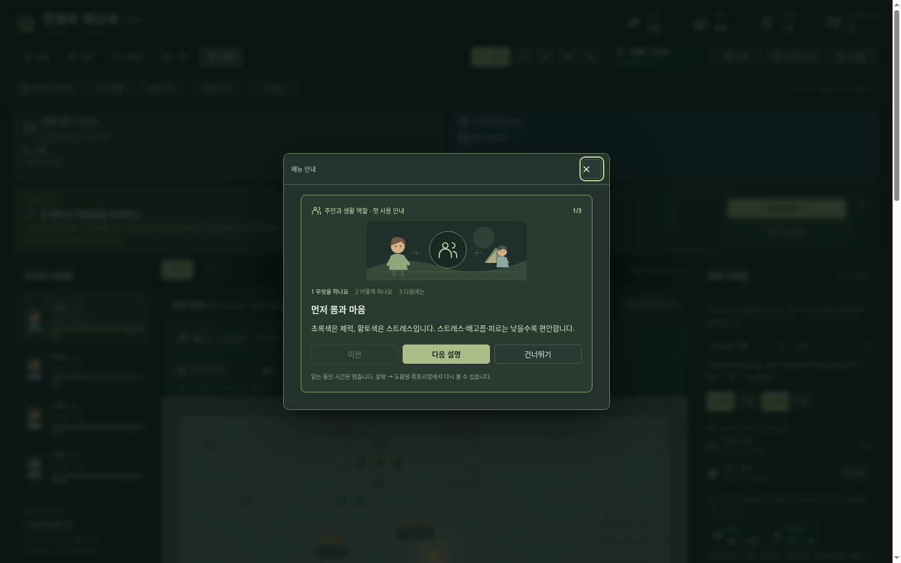
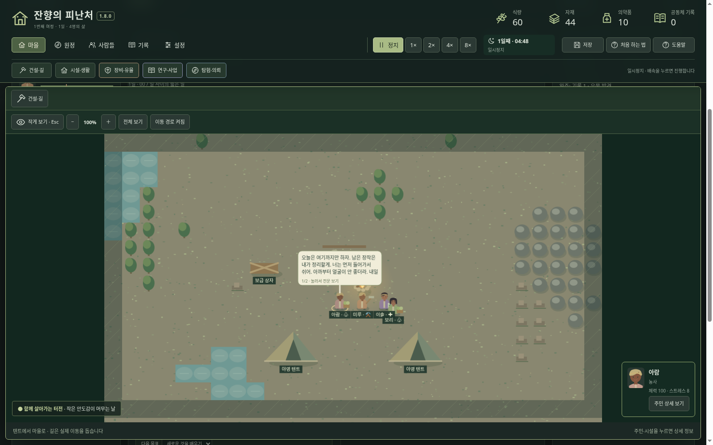
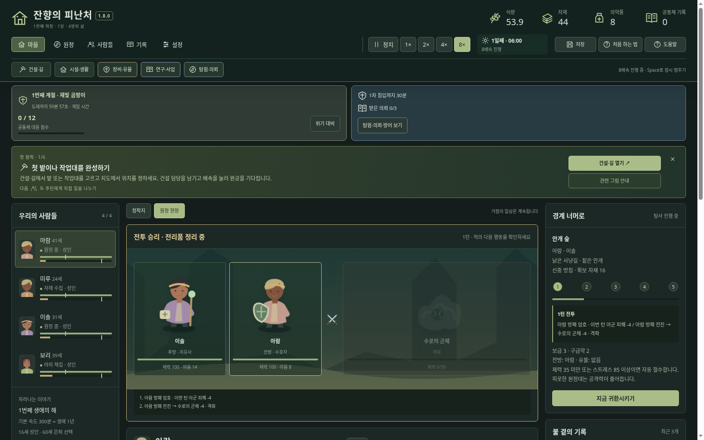
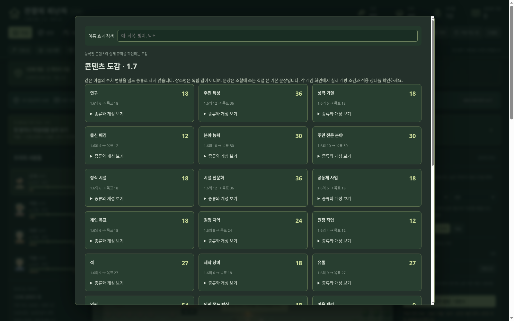
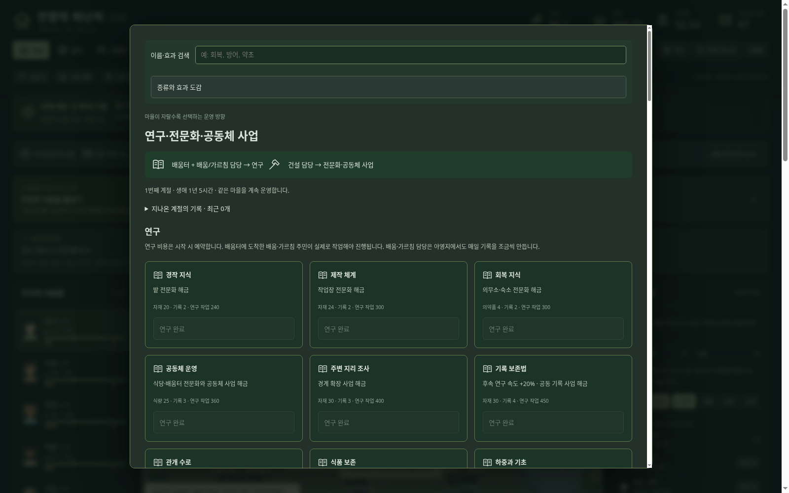
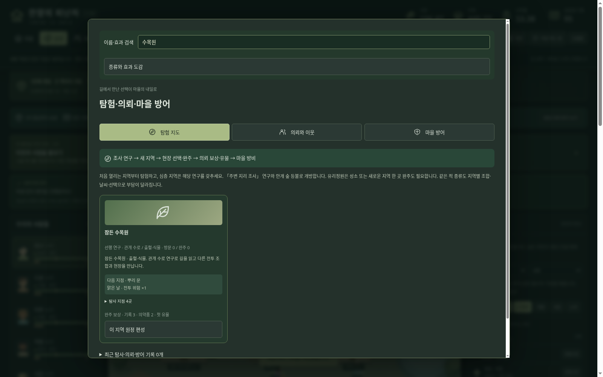
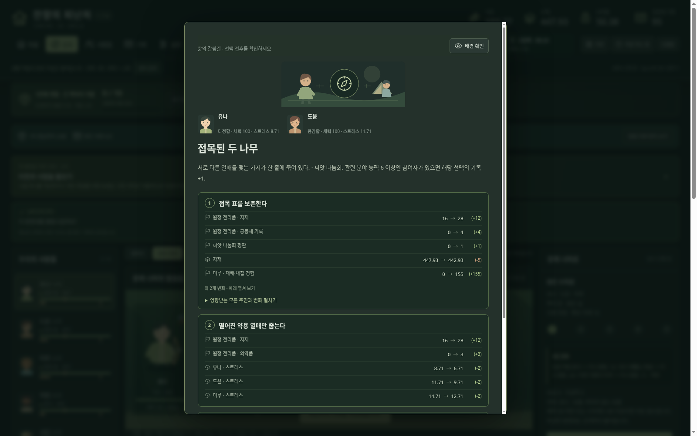
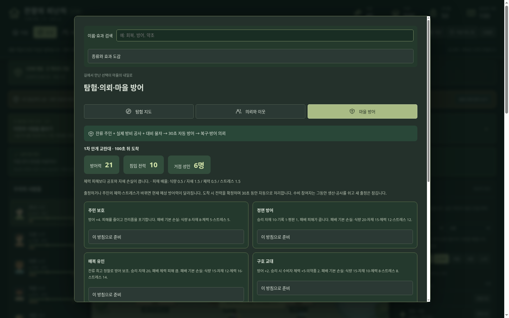

# 잔향의 피난처 — Windows 다운로드

## 최신판: 1.8.0 · 조작·가독성 개선 1단계

**[윈도우 본판 ZIP 다운로드](https://github.com/wkion154/-/raw/refs/heads/downloads/releases/Hearth-of-Echoes-1.8.0-Windows-x64.zip)**

이전 첫 안내·비용 표시 작업과 사용자의 UI 의견을 합친 버전입니다. 기존 1.7 저장으로 이어서 할 수 있습니다. 대화·외형·성별/연애 관계의 큰 개편은 다음 단계이며 이번에 모두 구현했다고 표현하지 않습니다.

### 실행과 업데이트

1. 이전 게임에서 저장하고 **브라우저 게임 탭과 검은 실행 창을 모두 닫습니다**.
2. 새 ZIP 전체를 새 폴더에 압축 해제합니다.
3. `Start.cmd`를 실행하고 **같은 브라우저에서 이어하기**를 선택합니다.

Windows 10/11 x64와 최신 Edge/Chrome용입니다. 공식 Node 런타임이 포함되어 별도 설치·인터넷·API 키가 필요 없습니다. 같은 주소 127.0.0.1:43187의 저장을 사용합니다. 설정에서 저장을 내보내 사본을 보관할 수 있습니다.

### 이번에 달라진 점

- **바닥·말풍선·이름표:** 아홉 시작 조건의 검은 바닥을 수정했습니다. 작은 세 줄 말풍선과 긴 대사 페이지·전문 보기, 지도 확대에 맞춘 이름표를 적용합니다.
- **고르게 정렬된 UI:** 아이콘 유무·잠금·비활성 상태에서 버튼 크기를 유지합니다. 도움말 카드와 안내 버튼도 통일합니다. 알림은 계절·침입/의뢰·최근 결과 카드로 나누고 목적별로 색을 구분합니다.
- **펼침 유지와 시각적 결과:** 실시간 갱신에도 상세가 닫히지 않습니다. 최근 변화는 아이콘/증감 배지, 체력·마음·관계·능력은 전후 게이지로 표시합니다. 일반 숫자는 최대 소수 한 자리로 정리합니다.
- **편리한 취소와 닫기:** 지도 배치 중 우클릭 취소, 일반 창 우측 상단 고정 ×·바깥 클릭·Esc를 지원합니다. 중요한 선택은 넘어가지 않으며 배경 확인으로 살펴봅니다.
- **목표·조건·대기 이유:** 실제 행동으로 완료되는 여섯 정착 실습, 관련 그림 안내, 기록 → 여정의 목표를 연결합니다. 작업이 멈춘 이유와 담당 주민, 비용·환불·예약/완공 시점을 확인합니다.
- **전투와 메뉴:** 아군 전방을 적과 가까운 오른쪽에 두고 피격·처치·짧은 승리 장면을 보여 줍니다. 기록/설정도 카테고리부터 선택하며 추모 기록은 기록에 모읍니다.

개척단 네 명·2/3인 원정과 1.7의 콘텐츠 종류는 유지합니다. 원정·건설·방어 중이던 실제 1.7/1.6 저장 이관을 검사했습니다. 아홉 시작 조건의 초기 운영 27회 결과 표도 1.7과 같습니다. 연출 때문에 전투나 보상을 재계산하지 않습니다.

[세부 변경·조작·검증 범위](notes-1.8.md) · [사용자 의견을 합친 3단계 계획](quality-roadmap-1.8.md) · [초기 운영 27회](polish-balance-1.8.md)

검증: **엔진 217개**, 33개 종류·참조, 초기 운영 27회, 실제 Chromium 포인터/키보드·잠금·닫기·알림 펼침·지도·전투와 기존 화면 조작 회귀, 압축본 CRC·내부 파일 SHA256·공식 런타임 체크섬을 확인합니다. **Windows 실기 실행은 미검증**입니다. 기능 검사 결과를 장시간 재미나 80~90점 완성도의 증명으로 보지는 않습니다.

### 화면 예시

---

## 이전판: 1.7.0 · 콘텐츠 종류 총 세 배 확장

**[윈도우 본판 ZIP 다운로드](https://github.com/wkion154/-/raw/refs/heads/downloads/releases/Hearth-of-Echoes-1.7.0-Windows-x64.zip)**

### 실행과 업데이트

1. 이전 게임에서 저장하고 **브라우저 게임 탭과 검은 실행 창을 모두 닫습니다**.
2. 새 ZIP 전체를 새 폴더에 압축 해제합니다.
3. `Start.cmd`를 실행하고 타이틀의 **이어하기**를 선택합니다.

같은 PC·브라우저·주소(127.0.0.1:43187)의 저장을 유지합니다. 설정 → 저장 내보내기로 사본을 보관할 수 있습니다. Windows 10/11 x64와 최신 Edge/Chrome용이며 공식 Node 런타임이 포함됩니다. 인터넷·API 키·별도 Node 설치가 필요 없습니다.

### 1.6 → 1.7 주요 수량

| 종류 | 이전 | 현재 |
|---|---:|---:|
| 연구 | 6 | **18** |
| 특성 / 성격 / 출신 | 12 / 6 / 4 | **36 / 18 / 12** |
| 능력 / 전문 분야 | 10 / 10 | **30 / 30** |
| 시설 / 시설 전문화 / 사업 | 6 / 12 / 6 | **18 / 36 / 18** |
| 개인 목표 | 6 | **18** |
| 원정 지역 / 직업 / 적 | 8 / 4 / 9 | **24 / 12 / 27** |
| 제작 장비 / 유물 | 6 / 9 | **18 / 27** |
| 의뢰 / 이웃 | 18 / 3 | **54 / 9** |
| 계절 위기 / 대비 물자 | 3 / 4 | **9 / 12** |
| 자동 침입 / 방어 방침 / 방비 사업 | 1 / 2 / 3 | **3 / 6 / 9** |
| 원정 선택 사건 / 마을 선택 사건 / 생활 사건 | 24 / 12 / 12 | **72 / 36 / 36** |
| 대화 주제 / 기본 발화 / 응답 | 15 / 90 / 60 | **45 / 270 / 180** |

개척단 네 명·원정 두 명 또는 세 명·공동 자원 네 가지는 유지합니다. 나머지 집계까지 포함한 [전체 33항목 실측표](content-audit-1.7.md)를 제공합니다. 장소명 96개는 독립 자유 이동 맵 수가 아닙니다.

### 각자의 역할과 실제 효과

- 연구 선행 조건과 다른 효과, 시설별 두 전문화, 실제 건설·제작·철거와 함께 확장합니다.
- 조리·야생 채집·석공·금속 가공·외과 처치·교수법 등 세부 기술은 관련 활동으로 성장합니다. 성격에 따라 자율 휴식·교류 시점과 대화 관심도 달라집니다.
- 기수·결투가·연금술사·공병·음유시인·수행자·돌격병·덫사냥꾼은 다른 전투 행동을 사용합니다. 새 적도 반사·약탈·회복·엄호·보급 소모 등 다른 공격 패턴을 갖습니다.
- 새 지역 열여섯 곳은 각자의 연구 조건·현장 사건·적 조합·완주 유물로 연결합니다. 그림은 기존 실루엣과 표식·색을 조합하며 모든 적의 독립 원화를 새로 그렸다는 뜻은 아닙니다.
- 약탈대·야수·교란대의 피해 비중이 다르고 여섯 방어 방침에서 잔류 정찰·교육·건설도 활용합니다. 개별 벽·문 배치나 건물 파괴 전술전은 포함하지 않습니다.
- **설정 → 콘텐츠 도감**에서 수량과 효과를 확인하세요. 연구·건설·시설·장비·탐험 메뉴에도 이름·효과 검색을 넣었습니다. 첫 사용 안내와 설정에서 다시 보기도 제공합니다.

실제 1.6 배포본의 전투·건설·방어 저장을 이관해 기존 물자와 진행을 보존하는지 검사했습니다. 기존 마을을 새로 만들 필요가 없습니다. 더 오래된 호환 방식은 연구·사업에서 장기 정착으로 전환할 수 있습니다.

[전체 변경·규칙·한계](notes-1.7.md) · [초기 물자 그대로 27회 운영](expansion-balance-1.7.md) · [이전 1.6 업데이트](notes-1.6.md)

검증: 엔진 테스트 **199개**, 33항목 수량·참조 검사, 아홉 터전 × 정착/2인/3인 운영 **27회**, 새 지역 열여섯 곳의 실제 전투·선택·완주·귀환 저장, 세 침입 × 여섯 방침의 승패, Chromium·압축 해제 배포본과 기존 조작 회귀를 확인했습니다. 공식 런타임 체크섬·ZIP CRC·내부 파일 SHA256을 검증했습니다. **Windows 실기 실행은 미검증**입니다. 종류 확장은 수백 시간의 재미나 모든 조합의 장기 균형을 검증했다는 뜻은 아닙니다.
