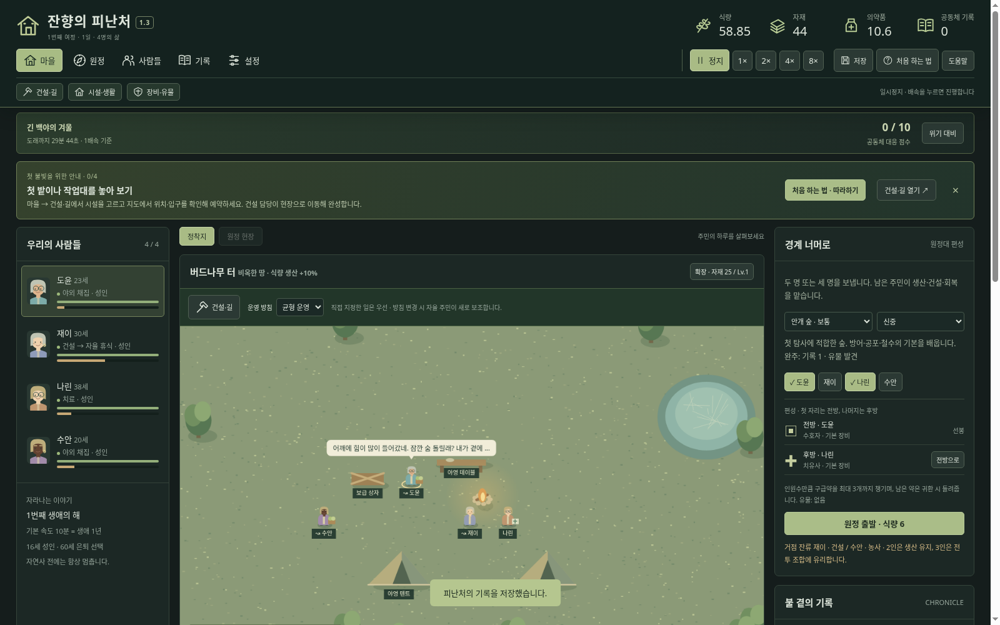
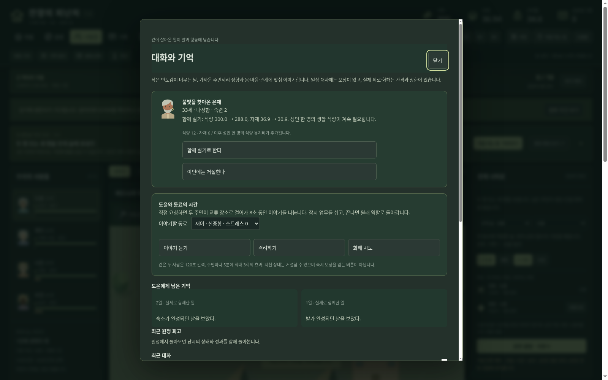

# 잔향의 피난처 — Windows 다운로드

## 최신판: 1.3.0 · 기억이 쌓이는 네 사람의 마을

**[윈도우 본판 ZIP 다운로드](https://github.com/wkion154/-/raw/refs/heads/downloads/releases/Hearth-of-Echoes-1.3.0-Windows-x64.zip)**

### 실행과 업데이트

1. 이전 게임을 저장하고 브라우저 게임 탭과 검은 실행 창을 모두 닫습니다.
2. 새 ZIP 전체를 새 폴더에 압축 해제합니다.
3. `Start.cmd`를 더블클릭합니다. 같은 PC·브라우저에서는 기존 저장이 이어집니다.

Windows 10/11 x64와 최신 Edge 또는 Chrome용입니다. Node.js 런타임이 포함되어 별도 설치·인터넷·API 키가 필요 없습니다. 게임 중 실행 창을 열어 두세요.

**기존 여섯 명과 시설은 유지됩니다.** 새로운 네 명의 야영지를 경험하려면 먼저 **설정 → 저장 내보내기**로 보관한 뒤 **새 여정**을 선택하세요. 주민을 확정하기 전에는 취소해 기존 마을로 돌아갈 수 있습니다. 확정하면 현재 저장이 새 게임으로 바뀝니다.

### 이번 업데이트

- **성격과 상황에 맞는 대화:** 여섯 성향, 부상·스트레스·피로·관계·가족·식량·건설·원정 상황을 반영합니다. 가까운 주민 사이의 대화와 혼잣말을 지도 말풍선과 기록에서 봅니다.
- **직접 만날 시간 마련:** 사람들 → 대화·기억에서 동료를 골라 이야기 듣기·격려·화해를 요청합니다. 두 사람이 걸어가 잠시 업무를 쉬고 대화하며, 지친 상대는 거절할 수 있습니다.
- **실제로 남는 기억:** 위로·화해·완공·귀환 당시의 회고를 기록하고, 받았던 도움을 나중에 이야기합니다. 실제 사회 효과에는 전후 수치·재사용 간격·상한이 있습니다.
- **선택하는 새 동료:** 8분 이후 찾아오는 생존자를 잠자리·물자·생활 유지비를 확인해 수락하거나 거절합니다. 자동 합류하지 않습니다.
- **더 천천히 함께 사는 시간:** 새 게임은 생애 1년이 게임 시간 10분입니다. 기존 저장은 나이·연내 진행과 기존 2분/년 속도를 유지합니다. 위기는 30분 기한과 10분 이후 조기 대응을 유지합니다.

**[상세 업데이트 설명](notes-1.3.md)** · [2단계 설명](notes-1.2.md)

계획했던 세 단계가 이번 버전까지 반영됐습니다. 대화는 직접 쓴 장면과 실제 상태·기억을 조합해 오프라인으로 동작하며, 자유 입력형 AI나 무한 생성 대화는 아닙니다.

네 명 주사위·잠금·꾸미기, 텐트에서 시작해 직접 짓는 시설과 길, 2인·3인 원정, 사건 배경 확인·시간 정지·자원 전후 표시도 유지합니다. 각 메뉴 첫 안내는 **설정 → 도움말·튜토리얼**에서 다시 볼 수 있습니다. 말풍선은 **설정 → 주민 대화 말풍선**에서 끕니다.

저장은 같은 PC·브라우저에 보존됩니다. 다른 PC나 브라우저로 옮길 때는 저장 내보내기·불러오기를 사용하세요.

검증: 규칙 테스트 **137개**, 실제 규칙 자동 플레이 **42회**, 압축 해제본의 기존 플레이·1단계 UI·2단계 UI·3단계 UI 브라우저 검증을 통과했습니다. Windows 실기 실행은 미검증입니다. 공식 런타임 체크섬, ZIP CRC와 내부 파일 SHA256을 확인했으며 배포 ZIP의 SHA256 파일을 함께 제공합니다.
